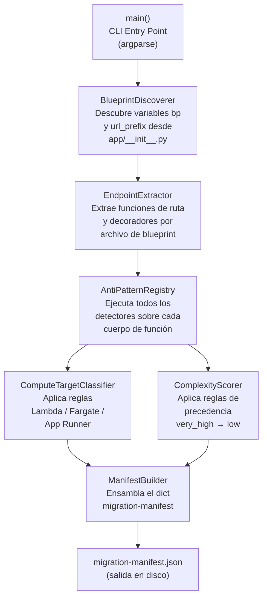

# Documento de Diseño Técnico — Skill 01: Analizador de Monolito

**Feature:** `skill-01-analyzer`  
**Versión:** 1.0.0  
**Autor:** Luis Gerardo Sánchez Ordóñez  
**Proyecto:** Trabajo de Grado — Maestría en Ingeniería de Software, Pontificia Universidad Javeriana Cali  
**Director:** Juan Gabriel Quintero Barbosa — Head Solutions Architecture, Amazon Web Services Colombia  

---

## Overview

El Skill 01 es el punto de entrada del pipeline de migración asistida por Agent Skills. Examina el código fuente de un monolito Flask mediante análisis estático del Árbol de Sintaxis Abstracta (AST), sin ejecutar el código ni transmitirlo a servicios externos, y produce el archivo `migration-manifest.json` que actúa como contrato de datos para los Skills 02 al 05.

El Skill se distribuye como paquete instalable en Kiro IDE siguiendo el estándar agentskills.io. Su componente central es el script Python `analyze_monolith.py`, que opera exclusivamente sobre archivos locales del workspace del desarrollador usando únicamente módulos de la biblioteca estándar de Python (`ast`, `os`, `json`, `pathlib`, `re`, `datetime`, `argparse`), sin dependencias externas para el caso de uso básico.

La aplicación monolítica de referencia es *Taller PyME*, un sistema de gestión de taller de reparaciones electrónicas desarrollado en Flask 2.3.3 con 5 blueprints y 29 endpoints REST. Los resultados concretos esperados sobre este monolito son:

- **29 endpoints** descubiertos en 5 módulos.
- **28 endpoints** clasificados como destino `"lambda"`.
- **1 endpoint** (`POST /api/transacciones/{id}/adjunto`) clasificado como `"lambda"` con `requires_architectural_transformation: true`.
- **5 anti-patrones** documentados: `AP-token-blacklist` (auth), `AP-local-filesystem` (transacciones), `AP-strftime-sqlite` (reportes), `AP-session-flask` (auth), `AP-order-num-ts` (transacciones).

---

## Architecture

El script `analyze_monolith.py` se organiza en una cadena de procesamiento lineal con siete componentes principales. Cada componente tiene una responsabilidad única y acotada, pasando su resultado al siguiente como entrada.



### Principios arquitectónicos del script

1. **Sin dependencias externas:** Todos los componentes usan exclusivamente la biblioteca estándar de Python 3.9+.
2. **Análisis en memoria:** Los archivos Python se leen como cadenas de texto; la función `ast.parse()` construye los árboles sin ejecutar el código (`exec`, `eval` e `importlib.import_module` están explícitamente prohibidos).
3. **Tolerancia a fallos por archivo:** Un error de sintaxis en un archivo Python aislado no interrumpe el análisis del resto del directorio; el archivo se omite y se registra una advertencia en el manifiesto.
4. **Detectores independientes:** Cada detector de anti-patrones opera sobre el nodo AST de la función de ruta de forma aislada; la detección en una función no contamina el estado de análisis de otras funciones.
5. **Salida determinista:** Para el mismo directorio de entrada, el manifiesto producido es idéntico en contenido (aunque no necesariamente en el campo `analyzed_at`).

---

## Components and Interfaces

### 1. `BlueprintDiscoverer`

**Responsabilidad:** Determinar el mapeo entre nombre de variable de blueprint y su prefijo de URL (`url_prefix`), y localizar los archivos `routes.py` de cada blueprint.

**Entrada:** Ruta absoluta del directorio del monolito.

**Salida:** Diccionario `{nombre_variable_bp: {prefix: str, routes_file: Path}}`.

**Estrategia de implementación:**

El descubrimiento opera en dos pasos:

**Paso 1 — Parseo de `app/__init__.py`:** El componente busca la función `_registrar_blueprints` (o equivalente) en el archivo `app/__init__.py`. Busca nodos `ast.Call` donde la función llamada es `app.register_blueprint` con dos argumentos: el nombre de la variable blueprint y el keyword `url_prefix`. El patrón AST objetivo es:

```python
# Código fuente en app/__init__.py
app.register_blueprint(auth_bp,          url_prefix='/api/auth')
app.register_blueprint(clientes_bp,      url_prefix='/api/clientes')
app.register_blueprint(servicios_bp,     url_prefix='/api/servicios')
app.register_blueprint(transacciones_bp, url_prefix='/api/transacciones')
app.register_blueprint(reportes_bp,      url_prefix='/api/reportes')
```

El nodo AST para `app.register_blueprint(auth_bp, url_prefix='/api/auth')` tiene la estructura:
- `node.func`: `ast.Attribute` con `attr='register_blueprint'`
- `node.args[0]`: `ast.Name` con `id='auth_bp'` (nombre de la variable)
- El keyword `url_prefix`: `ast.keyword` con `arg='url_prefix'` y `value=ast.Constant(value='/api/auth')`

**Paso 2 — Búsqueda de archivos de rutas:** Para cada variable de blueprint descubierta, el componente busca recursivamente en el directorio del monolito un archivo Python que contenga la declaración `<nombre_variable> = Blueprint(...)`. Cuando el archivo `routes.py` usa exactamente el mismo nombre de variable que `app/__init__.py`, la correlación es directa. En caso de no encontrar coincidencia en el nombre de variable, el componente recurre a la búsqueda por ruta de importación (`from .blueprints.<modulo>.routes import <var>`).

**Interfaz:**

```python
class BlueprintDiscoverer:
    def __init__(self, monolith_path: Path) -> None: ...
    def discover(self) -> dict[str, BlueprintInfo]: ...
    # BlueprintInfo = TypedDict con: prefix: str, routes_file: Path, module_name: str
```

---

### 2. `EndpointExtractor`

**Responsabilidad:** Parsear un archivo `routes.py` y extraer todas las funciones de ruta con su información básica (método HTTP, ruta URL, decoradores, nombre de función).

**Entrada:** `Path` del archivo `routes.py` + `BlueprintInfo` correspondiente.

**Salida:** Lista de `EndpointNode` (dataclass interna con el nodo AST de la función + metadatos básicos).

**Estrategia de recorrido AST:**

El componente usa `ast.walk()` sobre el árbol del archivo para encontrar nodos `ast.FunctionDef`. Para cada función, examina su lista `decorator_list` buscando decoradores que sean llamadas (`ast.Call`) sobre un atributo con `attr='route'`. El patrón objetivo es:

```python
# Decorador en código fuente
@transacciones_bp.route('/<int:orden_id>/adjunto', methods=['POST'])
```

El nodo AST correspondiente tiene la estructura:
- `decorator`: `ast.Call`
- `decorator.func`: `ast.Attribute` con `attr='route'`
- `decorator.func.value`: `ast.Name` con `id='transacciones_bp'` (nombre de la variable bp)
- `decorator.args[0]`: `ast.Constant` con `value='/<int:orden_id>/adjunto'` (ruta relativa)
- Keyword `methods`: `ast.keyword` con `arg='methods'` y `value=ast.List` cuyos elementos son `ast.Constant` con los métodos HTTP

**Construcción de la ruta completa:**

La ruta URL completa se construye concatenando el prefijo del blueprint con la ruta relativa del decorador:

```
url_prefix='/api/transacciones'  +  '/<int:orden_id>/adjunto'
→  '/api/transacciones/{orden_id}/adjunto'   (convirtiendo <int:var> a {var})
```

La conversión de los parámetros de Flask (`<int:var>`, `<string:var>`, `<var>`) al formato estándar `{var}` se realiza con una expresión regular: `re.sub(r'<(?:\w+:)?(\w+)>', r'{\1}', ruta_relativa)`.

**Detección de `auth_required` y `admin_required`:**

Para cada función de ruta, el componente verifica:

- `auth_required`: existe en `decorator_list` un `ast.Call` o `ast.Name` cuyo identificador sea `jwt_required`.
- `admin_required`: existe en el cuerpo de la función (`function.body`) un nodo de comparación (`ast.Compare`) donde el operando izquierdo sea `ast.Subscript` sobre `ast.Call` a `get_jwt()` con slice `'rol'`, o una llamada a `claims.get('rol')` con comparación a `'admin'`.

**Interfaz:**

```python
class EndpointExtractor:
    def __init__(self, routes_file: Path, blueprint_info: BlueprintInfo) -> None: ...
    def extract(self) -> list[EndpointNode]: ...
    # EndpointNode tiene: func_node, method, full_path, relative_path,
    #                     auth_required, admin_required, module_name, func_name
```

---

### 3. `AntiPatternRegistry`

**Responsabilidad:** Coordinar la ejecución de todos los detectores de anti-patrones sobre cada función de ruta y el módulo completo.

**Entrada:** Árbol AST del archivo completo + lista de `EndpointNode`.

**Salida:** Para cada `EndpointNode`, lista de anti-patrones detectados; para el módulo, lista de anti-patrones a nivel de módulo.

**Detectores registrados:**

El registro mantiene dos tipos de detectores: **detectores de función** (que se ejecutan sobre el cuerpo de cada función de ruta) y **detectores de módulo** (que se ejecutan sobre el árbol completo del archivo).

#### 3.1 `LocalFilesystemDetector` (detector de función)

Detecta el anti-patrón `AP-local-filesystem` (GAP-02). Busca en el cuerpo de la función:

1. Nodos `ast.Call` donde `func` es `ast.Attribute` con `attr='save'`, y el objeto sobre el que se llama `.save()` es una suscripción de `request.files` — patrón: `request.files['archivo'].save(ruta)`.
2. Nodos `ast.Call` a `os.path.join` donde uno de los argumentos es un nombre de variable asociado a `UPLOAD_FOLDER` o el acceso `current_app.config['UPLOAD_FOLDER']`.

Ejemplo en `transacciones/routes.py`:
```python
archivo.save(ruta_destino)  # ← activa AP-local-filesystem
ruta_destino = os.path.join(current_app.config['UPLOAD_FOLDER'], nombre_final)  # ← también activa
```

**Resultado cuando activa:** `{code: "AP-local-filesystem", gap_ids: ["GAP-02"], severity: "critical"}`.

#### 3.2 `StrftimeDetector` (detector de función)

Detecta el anti-patrón `AP-strftime-sqlite` (GAP-04). Busca nodos `ast.Call` donde `func` es `ast.Attribute` con `attr='strftime'` y el objeto sobre el que se llama `strftime` es a su vez una llamada a un objeto `func` (patrón: `func.strftime(formato, columna)`).

Ejemplo en `reportes/routes.py`:
```python
func.strftime(formato_fecha, OrdenTrabajo.fecha_completado).label('periodo')
# ↑ activa AP-strftime-sqlite
```

**Resultado cuando activa:** `{code: "AP-strftime-sqlite", gap_ids: ["GAP-04"], severity: "high"}`.

#### 3.3 `SessionDetector` (detector de función)

Detecta el anti-patrón `AP-session-flask` (GAP-06). Busca en el cuerpo de la función:

1. Nodos `ast.Subscript` donde el valor es `ast.Name` con `id='session'` — patrón: `session['usuario_id']`.
2. Nodos `ast.Call` donde `func` es `ast.Attribute` con `attr='clear'` sobre `ast.Name` con `id='session'` — patrón: `session.clear()`.

Ejemplo en `auth/routes.py`:
```python
session['usuario_id'] = usuario.id   # ← activa AP-session-flask
session.clear()                       # ← también activa
```

**Resultado cuando activa:** `{code: "AP-session-flask", gap_ids: ["GAP-06"], severity: "medium"}`.

#### 3.4 `TimestampIdDetector` (detector de función)

Detecta el anti-patrón `AP-order-num-ts` (GAP-14). Busca en el cuerpo de la función nodos `ast.Call` a `datetime.utcnow()` cuyo resultado sea asignado a una variable que posteriormente se usa en una f-string (`ast.JoinedStr`) o en una llamada a `.strftime()`, sugiriendo construcción de un identificador de texto basado en timestamp.

Ejemplo en `app/utils/helpers.py` (llamada desde `transacciones/routes.py`):
```python
ahora = datetime.utcnow()
return f"OT-{ahora.strftime('%Y%m%d-%H%M%S')}"  # ← activa AP-order-num-ts
```

El detector busca el patrón en el cuerpo de `crear_orden()` a través de la llamada a `generar_numero_orden()`. Dado que la llamada indirecta a través de helpers no es trazable sin ejecución, el detector también analiza la declaración de la función `generar_numero_orden` si se encuentra en el mismo workspace.

**Resultado cuando activa:** `{code: "AP-order-num-ts", gap_ids: ["GAP-14"], severity: "medium"}`.

#### 3.5 `TokenBlacklistDetector` (detector de módulo)

Detecta el anti-patrón `AP-token-blacklist` (GAP-03). Busca a **nivel de módulo** (no dentro de funciones):

1. Una asignación `ast.Assign` donde el valor es `ast.Call` a `set()` y el objetivo es un nombre de variable a nivel de módulo (variable global, no local a una función) — patrón: `_tokens_revocados = set()`.
2. En el cuerpo de funciones de ruta del mismo módulo, acceso a `.add()` sobre la misma variable — patrón: `_tokens_revocados.add(jti)`.

Ejemplo en `auth/routes.py`:
```python
# Nivel de módulo
_tokens_revocados = set()  # ← paso 1: asignación de set() a nivel módulo

# Dentro de función de ruta
_tokens_revocados.add(jti)  # ← paso 2: .add() dentro de función de ruta
```

La combinación de ambos patrones activa el detector. El anti-patrón se registra en el módulo y en el endpoint que contiene la llamada `.add()`.

**Resultado cuando activa:** `{code: "AP-token-blacklist", gap_ids: ["GAP-03"], severity: "high"}`.

#### 3.6 `CrossBlueprintDetector` (detector de módulo)

Detecta el anti-patrón `AP-cross-blueprint`. Busca en las sentencias de importación de **nivel de módulo** (`ast.ImportFrom`) cuyo `module` siga el patrón `app.blueprints.<nombre_modulo>.routes`.

Ejemplos detectados en el monolito de referencia:
```python
# En transacciones/routes.py
from app.blueprints.clientes.routes import verificar_cliente_existe
# ↑ activa AP-cross-blueprint: registra dependencia "transacciones → clientes"

# En reportes/routes.py
from app.blueprints.servicios.routes import CATEGORIAS
# ↑ activa AP-cross-blueprint: registra dependencia "reportes → servicios"
```

El anti-patrón se registra en **todos los endpoints del módulo importador** y la dependencia se añade al campo `cross_blueprint_imports` del módulo en el manifiesto.

**Resultado cuando activa:** `{code: "AP-cross-blueprint", gap_ids: [], severity: "high", dependencies: ["transacciones → clientes"]}`.

#### 3.7 `InMemorySingletonDetector` (detector de módulo)

Detecta el anti-patrón `AP-in-memory-singleton`. Busca a nivel de módulo:

1. Un atributo de clase `_instancia = None` dentro de un método `__new__` que asigna a `cls._instancia` — patrón Singleton canónico (como en `CacheService`).
2. Alternativamente, una variable de módulo tipo `_cache = {}` o `_historial = []` con nombres sugestivos de estado compartido.

**Resultado cuando activa:** `{code: "AP-in-memory-singleton", gap_ids: [], severity: "medium"}`.

**Interfaz del registro:**

```python
class AntiPatternRegistry:
    FUNCTION_DETECTORS: list[type]   # [LocalFilesystemDetector, StrftimeDetector, ...]
    MODULE_DETECTORS: list[type]     # [TokenBlacklistDetector, CrossBlueprintDetector, ...]

    def analyze_module(
        self,
        module_tree: ast.Module,
        endpoints: list[EndpointNode]
    ) -> ModuleAnalysisResult:
        # ModuleAnalysisResult contiene:
        # - endpoint_antipatterns: dict[func_name, list[AntiPatternMatch]]
        # - module_antipatterns: list[AntiPatternMatch]
        # - cross_blueprint_imports: list[str]
```

---

### 4. `ComplexityScorer`

**Responsabilidad:** Asignar el valor de `migration_complexity` a cada endpoint según reglas de precedencia estrictamente ordenadas.

**Entrada:** `EndpointNode` + lista de anti-patrones detectados para ese endpoint.

**Salida:** Valor de `migration_complexity` ∈ `{"very_high", "high", "medium", "low"}`.

**Reglas de precedencia (en orden decreciente, se aplica la primera que sea verdadera):**

| Nivel | Condición |
|---|---|
| `very_high` | `AP-local-filesystem` presente en el endpoint |
| `high` | `AP-strftime-sqlite` presente, O `AP-cross-blueprint` presente, O el cuerpo contiene llamadas a `notificacion_service.*`, O el cuerpo contiene un diccionario de transiciones de máquina de estados (`transiciones = {'pendiente': [...], ...}`) |
| `medium` | El cuerpo referencia `cache_service`, O importa modelos de múltiples dominios, O contiene `get_jwt_identity()` con lógica de negocio no trivial (más de una línea tras la extracción de identity) |
| `low` | Ninguna condición anterior aplica |

**Ejemplos sobre el monolito de referencia:**

| Endpoint | Anti-patrones activos | Complexity asignada |
|---|---|---|
| `POST /api/transacciones/{id}/adjunto` | `AP-local-filesystem` | `very_high` |
| `GET /api/reportes/ingresos` | `AP-strftime-sqlite` | `high` |
| `POST /api/transacciones/` | `AP-cross-blueprint`, llamadas a `notificacion_service` | `high` |
| `GET /api/clientes/` | `cache_service` | `medium` |
| `POST /api/auth/register` | Ninguno | `low` |

**Interfaz:**

```python
class ComplexityScorer:
    def score(
        self,
        endpoint: EndpointNode,
        antipatterns: list[AntiPatternMatch],
        module_tree: ast.Module
    ) -> Literal["very_high", "high", "medium", "low"]: ...
```

---

### 5. `ComputeTargetClassifier`

**Responsabilidad:** Asignar el destino de cómputo AWS recomendado a cada endpoint.

**Entrada:** `EndpointNode` + lista de anti-patrones + `migration_complexity`.

**Salida:** `compute_target` ∈ `{"lambda", "fargate", "app_runner"}` + campo opcional `requires_architectural_transformation: bool`.

**Árbol de decisión:**

```
¿El cuerpo contiene loops sobre colecciones no paginadas de tamaño indeterminado,
o requiere estado temporal en el sistema de archivos entre sub-invocaciones?
  → SÍ: "fargate"

¿El módulo expone ÚNICAMENTE endpoints HTTP de lectura pública (sin JWT),
sin operaciones de escritura ni efectos secundarios?
  → SÍ: "app_runner"

→ Por defecto: "lambda"
  Si además tiene AP-local-filesystem:
    → "lambda" + requires_architectural_transformation: true
```

**Resultado para el monolito de referencia:**

El análisis determina que los 29 endpoints se clasifican como `"lambda"`. Ningún módulo del monolito cumple los criterios para Fargate ni App Runner:
- No hay bucles sobre colecciones no paginadas de tamaño indeterminado en el sentido de procesamiento batch (el bucle sobre técnicos en `reporte_tecnicos()` itera sobre una colección acotada de empleados activos).
- Ningún módulo cumple el criterio de "solo endpoints de lectura pública sin escrituras" — el módulo `servicios` tiene tres endpoints públicos de lectura pero también tiene tres endpoints de escritura autenticados.

El endpoint `POST /api/transacciones/{id}/adjunto` recibe `requires_architectural_transformation: true` por la presencia de `AP-local-filesystem`.

**Interfaz:**

```python
class ComputeTargetClassifier:
    def classify(
        self,
        endpoint: EndpointNode,
        antipatterns: list[AntiPatternMatch],
        complexity: str,
        module_endpoints: list[EndpointNode]
    ) -> ComputeTargetResult:
        # ComputeTargetResult: compute_target + requires_architectural_transformation
```

---

### 6. `ManifestBuilder`

**Responsabilidad:** Ensamblar todos los resultados de los componentes anteriores en el diccionario del manifiesto y escribirlo en disco como JSON.

**Entrada:** Resultados de todos los componentes para todos los módulos.

**Salida:** `dict` del manifiesto + escritura del archivo `migration-manifest.json`.

**Determinación de cohesión e isolamiento de módulos:**

El `ManifestBuilder` calcula los campos `cohesion` e `isolation` de cada módulo usando heurísticas basadas en el análisis:

- **`cohesion`**: `"high"` si todos los endpoints del módulo operan sobre la misma entidad de dominio; `"medium"` si hay mezcla de responsabilidades detectada (p. ej., `transacciones` mezcla CRUD con upload y máquina de estados); `"low"` si el módulo importa de múltiples dominios (p. ej., `reportes` que importa `Usuario`, `Cliente`, `Servicio`, `OrdenTrabajo`, `DetalleOrden`).

- **`isolation`**: `"high"` si no hay importaciones cross-blueprint ni exportaciones de funciones usadas externamente; `"medium"` si se detectan importaciones diferidas de modelos de otros dominios; `"low"` si el módulo tiene importaciones directas desde otros blueprints.

**Lambda Layers recomendadas:**

El `ManifestBuilder` deriva la lista de Lambda Layers recomendadas del análisis de dependencias compartidas:

| Layer | Contenido | Usado por |
|---|---|---|
| `taller-db-layer` | Modelos SQLAlchemy refactorizados, inicialización de conexión RDS Proxy | Todos los módulos |
| `taller-auth-layer` | Validación JWT sin Flask-JWT-Extended, consulta DynamoDB para blacklist | `auth` + Autorizador Lambda de API GW |
| `taller-utils-layer` | Funciones auxiliares sin dependencias Flask, constante `CATEGORIAS`, generador UUID | Todos los módulos |

**Secuencia de migración:**

La secuencia se ordena por complejidad de acoplamiento creciente, siguiendo el patrón *Strangler Fig*:

| Fase | Módulo | Justificación |
|---|---|---|
| 1 | `servicios` | Menor acoplamiento; 3 endpoints públicos validan sin autenticación; sin efectos secundarios en otros módulos |
| 2 | `auth` | Establece el Autorizador Lambda compartido; externaliza blacklist a DynamoDB |
| 3 | `clientes` | Acoplamiento medio; `verificar_cliente_existe` migra a `taller-utils-layer` antes de esta fase |
| 4 | `reportes` | Módulo read-only; solo requiere corrección de `func.strftime()` |
| 5 | `transacciones` | Mayor complejidad; requiere transformación del endpoint de uploads y desacoplamiento de notificaciones |

**Interfaz:**

```python
class ManifestBuilder:
    def build(self, analysis_results: AllModulesResult) -> dict: ...
    def write(self, manifest: dict, output_path: Path) -> None: ...
```

---

### 7. `main()` — Punto de Entrada CLI

**Responsabilidad:** Parsear argumentos, orquestar la cadena de componentes, manejar errores fatales y escribir el resultado.

**Interfaz de línea de comandos:**

```
python analyze_monolith.py --path <ruta_monolito> [--output <ruta_manifiesto>]
```

| Parámetro | Descripción | Obligatorio |
|---|---|---|
| `--path` | Ruta al directorio raíz del monolito Flask a analizar | Sí |
| `--output` | Ruta destino del `migration-manifest.json`; por defecto es `<path>/migration-manifest.json` | No |

**Códigos de salida:**

| Código | Condición |
|---|---|
| `0` | Análisis completado exitosamente; manifiesto escrito |
| `1` | El directorio `--path` no existe en el sistema de archivos |
| `2` | No se encontraron blueprints Flask en el directorio |
| `3` | Error de escritura del manifiesto (se intenta fallback a `cwd`) |

**Mensajes de error a stderr (formato JSON):**

```json
{"error": "MONOLITH_PATH_NOT_FOUND", "path": "/ruta/inexistente", "timestamp": "2026-08-01T10:00:00Z"}
{"error": "NO_BLUEPRINTS_FOUND", "path": "/ruta/sin/blueprints", "timestamp": "2026-08-01T10:00:00Z"}
```

---

## Data Models

### Esquema completo de `migration-manifest.json`

A continuación se describe el esquema JSON del manifiesto con los tipos de cada campo y valores de ejemplo para el monolito de referencia.

```json
{
  "metadata": {
    "analyzed_at": "2026-08-01T10:30:00Z",        // string, ISO 8601 UTC
    "monolith_path": "/workspace/monolith",         // string, ruta absoluta
    "total_endpoints": 29,                           // integer
    "analyzer_version": "1.0.0",                    // string, semver
    "skill_version": "1.0.0",                       // string, semver
    "warnings": []                                   // array de strings (archivos con errores de sintaxis)
  },

  "modules": [
    {
      "name": "auth",                               // string
      "blueprint_variable": "auth_bp",             // string, nombre de la variable en routes.py
      "blueprint_prefix": "/api/auth",             // string, url_prefix de register_blueprint
      "routes_file": "app/blueprints/auth/routes.py", // string, ruta relativa al monolito
      "cohesion": "high",                           // "high" | "medium" | "low"
      "isolation": "low",                           // "high" | "medium" | "low"
      "anti_patterns": [
        {
          "code": "AP-token-blacklist",
          "description": "Lista negra de tokens JWT almacenada en set() en memoria del proceso",
          "gap_ids": ["GAP-03"],
          "severity": "high",
          "location": "_tokens_revocados = set()  # línea 24"
        },
        {
          "code": "AP-session-flask",
          "description": "Uso de session[] de Flask como mecanismo de autenticación complementario al JWT",
          "gap_ids": ["GAP-06"],
          "severity": "medium",
          "location": "session['usuario_id'] = usuario.id  # función login()"
        }
      ],
      "cross_blueprint_imports": [],
      "endpoints": [
        {
          "id": "auth.register",                   // string: <modulo>.<nombre_funcion>
          "method": "POST",                         // string, método HTTP
          "path": "/api/auth/register",             // string, ruta completa
          "relative_path": "/register",             // string, ruta relativa al blueprint
          "function_name": "register",             // string
          "auth_required": false,                   // boolean
          "admin_required": false,                  // boolean
          "compute_target": "lambda",               // "lambda" | "fargate" | "app_runner"
          "requires_architectural_transformation": false, // boolean
          "migration_complexity": "low",            // "low" | "medium" | "high" | "very_high"
          "anti_patterns": [],                      // array de códigos de anti-patrón
          "gap_ids": []                             // array de GAP IDs aplicables
        },
        {
          "id": "auth.login",
          "method": "POST",
          "path": "/api/auth/login",
          "relative_path": "/login",
          "function_name": "login",
          "auth_required": false,
          "admin_required": false,
          "compute_target": "lambda",
          "requires_architectural_transformation": false,
          "migration_complexity": "medium",
          "anti_patterns": ["AP-session-flask"],
          "gap_ids": ["GAP-06"]
        },
        {
          "id": "auth.logout",
          "method": "POST",
          "path": "/api/auth/logout",
          "relative_path": "/logout",
          "function_name": "logout",
          "auth_required": true,
          "admin_required": false,
          "compute_target": "lambda",
          "requires_architectural_transformation": false,
          "migration_complexity": "medium",
          "anti_patterns": ["AP-token-blacklist", "AP-session-flask"],
          "gap_ids": ["GAP-03", "GAP-06"]
        }
        // ... resto de endpoints de auth (me, password)
      ]
    },
    {
      "name": "transacciones",
      "blueprint_variable": "transacciones_bp",
      "blueprint_prefix": "/api/transacciones",
      "routes_file": "app/blueprints/transacciones/routes.py",
      "cohesion": "medium",
      "isolation": "low",
      "anti_patterns": [
        {
          "code": "AP-local-filesystem",
          "description": "Almacenamiento de archivos en el sistema de archivos local del servidor",
          "gap_ids": ["GAP-02"],
          "severity": "critical",
          "location": "archivo.save(ruta_destino)  # función subir_adjunto()"
        },
        {
          "code": "AP-cross-blueprint",
          "description": "Importación directa de función del blueprint de clientes",
          "gap_ids": [],
          "severity": "high",
          "location": "from app.blueprints.clientes.routes import verificar_cliente_existe"
        },
        {
          "code": "AP-order-num-ts",
          "description": "Generación de número de orden basada en timestamp, susceptible a colisiones",
          "gap_ids": ["GAP-14"],
          "severity": "medium",
          "location": "generar_numero_orden()  # usa datetime.utcnow()"
        }
      ],
      "cross_blueprint_imports": ["transacciones → clientes"],
      "endpoints": [
        // ...
        {
          "id": "transacciones.subir_adjunto",
          "method": "POST",
          "path": "/api/transacciones/{orden_id}/adjunto",
          "relative_path": "/<int:orden_id>/adjunto",
          "function_name": "subir_adjunto",
          "auth_required": true,
          "admin_required": false,
          "compute_target": "lambda",
          "requires_architectural_transformation": true,
          "migration_complexity": "very_high",
          "anti_patterns": ["AP-local-filesystem"],
          "gap_ids": ["GAP-02"]
        }
      ]
    }
    // ... módulos: clientes, servicios, reportes
  ],

  "lambda_layers": [
    {
      "name": "taller-db-layer",
      "description": "Modelos SQLAlchemy refactorizados e inicialización de conexión a RDS Proxy",
      "consumed_by": ["auth", "clientes", "servicios", "transacciones", "reportes"]
    },
    {
      "name": "taller-auth-layer",
      "description": "Validación JWT sin Flask-JWT-Extended y consulta DynamoDB para blacklist",
      "consumed_by": ["auth", "api-gateway-authorizer"]
    },
    {
      "name": "taller-utils-layer",
      "description": "Funciones auxiliares sin dependencias Flask, constante CATEGORIAS, generador UUID",
      "consumed_by": ["auth", "clientes", "servicios", "transacciones", "reportes"]
    }
  ],

  "migration_sequence": [
    {
      "phase": 1,
      "module": "servicios",
      "justification": "Menor acoplamiento; 3 endpoints públicos permiten validación sin autenticación",
      "prerequisites": ["taller-db-layer", "taller-utils-layer"]
    },
    {
      "phase": 2,
      "module": "auth",
      "justification": "Establece el Autorizador Lambda compartido; externaliza blacklist a DynamoDB",
      "prerequisites": ["DynamoDB tabla de tokens revocados", "SSM Parameter Store para JWT_SECRET_KEY"]
    },
    {
      "phase": 3,
      "module": "clientes",
      "justification": "verificar_cliente_existe migra a taller-utils-layer antes de esta fase",
      "prerequisites": ["taller-auth-layer", "phase-2-auth-completed"]
    },
    {
      "phase": 4,
      "module": "reportes",
      "justification": "Módulo read-only; corrección de func.strftime() es el único prerrequisito",
      "prerequisites": ["Aurora PostgreSQL operativo", "corrección func.strftime → func.to_char"]
    },
    {
      "phase": 5,
      "module": "transacciones",
      "justification": "Mayor complejidad; requiere transformación de uploads y desacoplamiento de notificaciones",
      "prerequisites": ["bucket S3 configurado", "cola SQS", "taller-notifications Lambda", "phase-3-clientes-completed"]
    }
  ],

  "summary": {
    "total_endpoints": 29,             // integer: suma de len(módulo.endpoints) para todos los módulos
    "lambda_candidates": 28,           // integer: endpoints con compute_target=lambda y requires_architectural_transformation=false
    "fargate_candidates": 0,           // integer
    "app_runner_candidates": 0,        // integer
    "requires_transformation": 1,      // integer: endpoints con requires_architectural_transformation=true
    "critical_blockers": 1,            // integer: endpoints con migration_complexity=very_high
    "anti_pattern_summary": {
      "AP-token-blacklist": 1,         // integer: count de endpoints con este anti-patrón
      "AP-local-filesystem": 1,
      "AP-strftime-sqlite": 1,
      "AP-session-flask": 2,
      "AP-order-num-ts": 1,
      "AP-cross-blueprint": 8,         // todos los endpoints de transacciones y reportes
      "AP-in-memory-singleton": 4      // módulos que usan cache_service
    }
  }
}
```

**Invariante de conteo verificable:**

```
summary.total_endpoints
  == sum(len(m.endpoints) for m in modules)                                         [I-1]

summary.lambda_candidates + summary.fargate_candidates
  + summary.app_runner_candidates + summary.requires_transformation
  == summary.total_endpoints                                                          [I-2]
```

---

## Correctness Properties

*Una propiedad es una característica o comportamiento que debe ser verdadera en todas las ejecuciones válidas de un sistema — esencialmente, un enunciado formal sobre lo que el sistema debe hacer. Las propiedades actúan como puente entre especificaciones legibles por humanos y garantías de corrección verificables por máquina.*

---

### Property 1: Completitud de campos obligatorios de endpoint

*Para cualquier* blueprint Flask sintéticamente generado que contenga al menos una función decorada con `@bp.route(path, methods=[...])`, cada endpoint producido por el `EndpointExtractor` SHALL contener los campos `id`, `method`, `path`, `auth_required`, `admin_required`, `compute_target`, y `migration_complexity` con valores no nulos. Adicionalmente, el campo `method` SHALL contener exclusivamente un valor del conjunto `{"GET", "POST", "PUT", "PATCH", "DELETE", "HEAD", "OPTIONS"}`.

**Validates: Requirements 1.2, 1.3, 1.4, 1.8, 8.2**

---

### Property 2: Dominio cerrado de `compute_target`

*Para cualquier* conjunto de blueprints Flask válidos analizados, el campo `compute_target` de cada endpoint en el manifiesto resultante SHALL contener exclusivamente uno de los valores `"lambda"`, `"fargate"` o `"app_runner"`, sin valores nulos ni valores fuera de ese conjunto.

**Validates: Requirements 3.4, 8.2**

---

### Property 3: Dominio cerrado y precedencia de `migration_complexity`

*Para cualquier* función de ruta con una combinación arbitraria de cero o más anti-patrones detectados, el campo `migration_complexity` SHALL contener exclusivamente uno de los valores `"low"`, `"medium"`, `"high"` o `"very_high"`, y el valor asignado SHALL ser el máximo nivel de precedencia correspondiente a los anti-patrones presentes (precedencia decreciente: `very_high` > `high` > `medium` > `low`). En particular: si `AP-local-filesystem` está presente, la complejidad SHALL ser `"very_high"` independientemente de qué otros anti-patrones estén presentes.

**Validates: Requirements 1.6, 8.3**

---

### Property 4: Invariante de conteo del summary

*Para cualquier* manifiesto generado por el Analizador, el valor del campo `summary.total_endpoints` SHALL ser igual a la suma de `len(modulo["endpoints"])` para todo módulo en `manifest["modules"]`. Formalmente:

```
summary.total_endpoints == Σ len(m["endpoints"]) ∀m ∈ manifest["modules"]
```

**Validates: Requirements 4.7, 8.4**

---

### Property 5: Round-trip de serialización JSON

*Para cualquier* manifiesto generado, la operación `json.loads(json.dumps(manifest))` SHALL producir un objeto `dict` cuyos campos `metadata`, `summary`, `modules`, `lambda_layers` y `migration_sequence` sean estructuralmente iguales a los del objeto original (mismas claves, mismos valores, mismos tipos primitivos). Esta propiedad garantiza que ningún campo del manifiesto contiene tipos Python no serializables como objetos `datetime`, `Path`, o nodos `ast.AST`.

**Validates: Requirements 4.8, 8.6**

---

### Property 6: Secuencia de migración no vacía

*Para cualquier* directorio de monolito Flask del que el Analizador descubra al menos un módulo con endpoints, el array `migration_sequence` en el manifiesto resultante SHALL contener al menos un elemento.

**Validates: Requirements 4.5, 8.5**

---

### Property 7: Detección del bloqueador crítico GAP-02

*Para cualquier* archivo Python que contenga exactamente una función de ruta con el método HTTP `POST` en cuyo cuerpo aparezca una llamada `.save()` sobre un objeto proveniente de `request.files`, el Analizador SHALL producir exactamente un endpoint con `migration_complexity = "very_high"`, `compute_target = "lambda"`, `requires_architectural_transformation = true`, y `"GAP-02"` presente en el array `gap_ids` del endpoint.

**Validates: Requirements 2.2, 3.5, 8.7**

---

### Property 8: Completitud de la detección cross-blueprint

*Para cualquier* par de módulos `(A, B)` donde el archivo `routes.py` del módulo `A` contiene una sentencia de importación de nivel de módulo de la forma `from app.blueprints.B.routes import <nombre>`, el Analizador SHALL registrar el anti-patrón `AP-cross-blueprint` en al menos un endpoint del módulo `A` y SHALL incluir la dependencia `"A → B"` en el campo `modules[A].cross_blueprint_imports` del manifiesto.

**Validates: Requirements 2.6, 2.8, 8.8**

---

### Property 9: Aislamiento de la detección por función

*Para cualquier* archivo Python con `N` funciones de ruta donde exactamente `K < N` de ellas contienen el anti-patrón `AP-strftime-sqlite` (o cualquier otro anti-patrón de función), el Analizador SHALL registrar el anti-patrón en exactamente `K` endpoints, sin que la presencia del anti-patrón en una función afecte el resultado del análisis de las demás funciones del mismo archivo.

**Validates: Requirements 2.9**

---

### Property 10: Partición completa del summary

*Para cualquier* ejecución del Analizador sobre blueprints Flask sintéticos con entre 1 y 50 endpoints, la suma `summary.lambda_candidates + summary.fargate_candidates + summary.app_runner_candidates + summary.requires_transformation` SHALL ser igual a `summary.total_endpoints`. Esta propiedad garantiza que cada endpoint es contado exactamente una vez en el resumen, sin omisiones ni duplicaciones.

**Validates: Requirements 8.10**

---

## Error Handling

### Errores fatales (interrumpen el análisis)

| Condición | Código de salida | Mensaje JSON a stderr |
|---|---|---|
| El directorio `--path` no existe | `1` | `{"error": "MONOLITH_PATH_NOT_FOUND", "path": "..."}` |
| No se encuentran blueprints | `2` | `{"error": "NO_BLUEPRINTS_FOUND", "path": "..."}` |

### Errores no fatales (el análisis continúa)

| Condición | Comportamiento | Campo en manifiesto |
|---|---|---|
| Un archivo `.py` tiene error de sintaxis | Omitir el archivo; continuar | `metadata.warnings[]: "SyntaxError en archivo.py: <mensaje>"` |
| No se puede parsear `app/__init__.py` | Usar heurísticas de nombre de archivo para inferir prefijos | `metadata.warnings[]: "No se pudo parsear __init__.py; usando heurísticas"` |
| El directorio de salida no tiene permisos de escritura | Escribir en `cwd` como fallback | `stdout: "Manifiesto escrito en <cwd>/migration-manifest.json"` |
| Un blueprint no tiene función de registro en `__init__.py` | Omitir el blueprint con una advertencia | `metadata.warnings[]: "Blueprint <var> sin registro encontrado"` |

### Diseño de tolerancia a fallos

El método `main()` envuelve la orquestación completa en un bloque `try/except Exception` de último recurso que garantiza que cualquier excepción no anticipada se traduce en un mensaje de error estructurado a stderr y un código de salida `1`, en lugar de un traceback Python no manejado. Esto implementa el requisito de "terminar sin unhandled exceptions" para cualquier entrada posible (Propiedad 10, Requisito 8.1).

---

## Testing Strategy

### Pruebas unitarias con ejemplos concretos

Las pruebas unitarias verifican comportamientos específicos con ejemplos del monolito de referencia:

1. **`test_blueprint_discovery_reference_monolith`**: Ejecuta `BlueprintDiscoverer` sobre `monolith/app/__init__.py` real y verifica que descubre exactamente los 5 blueprints con los prefijos correctos: `auth_bp → /api/auth`, `clientes_bp → /api/clientes`, etc.

2. **`test_endpoint_extraction_auth_blueprint`**: Ejecuta `EndpointExtractor` sobre `monolith/app/blueprints/auth/routes.py` y verifica los 5 endpoints con sus métodos, rutas y flags de autenticación correctos.

3. **`test_antipattern_token_blacklist_auth`**: Verifica que el `TokenBlacklistDetector` detecta `AP-token-blacklist` en `auth/routes.py` por la combinación de `_tokens_revocados = set()` (línea de módulo) + `_tokens_revocados.add(jti)` (dentro de `logout()`).

4. **`test_antipattern_local_filesystem_transacciones`**: Verifica que `LocalFilesystemDetector` detecta `AP-local-filesystem` en `transacciones/routes.py` por la llamada `archivo.save(ruta_destino)` en `subir_adjunto()`.

5. **`test_antipattern_strftime_reportes`**: Verifica que `StrftimeDetector` detecta `AP-strftime-sqlite` en `reportes/routes.py` por `func.strftime(formato_fecha, OrdenTrabajo.fecha_completado)`.

6. **`test_cross_blueprint_import_transacciones`**: Verifica que `CrossBlueprintDetector` registra `"transacciones → clientes"` en `cross_blueprint_imports` por la importación `from app.blueprints.clientes.routes import verificar_cliente_existe`.

7. **`test_full_analysis_reference_monolith`**: Prueba de integración completa que ejecuta `analyze_monolith.py --path monolith/` y verifica el manifiesto completo: 29 endpoints, 5 módulos, secuencia de 5 fases, `summary.critical_blockers = 1`, `summary.requires_transformation = 1`.

8. **`test_exit_code_missing_directory`**: Verifica que el proceso termina con código `1` y produce JSON de error a stderr cuando el directorio no existe.

9. **`test_json_output_is_parseable`**: Verifica que el archivo `migration-manifest.json` producido es JSON válido parseable con `json.loads()`.

### Pruebas basadas en propiedades con `hypothesis`

Las pruebas de propiedades verifican los invariantes del sistema sobre inputs generados aleatoriamente. La biblioteca seleccionada es `hypothesis` (versión 6.x), que no es dependencia del script de producción pero sí del entorno de pruebas.

**Configuración global de Hypothesis:**

```python
from hypothesis import settings, HealthCheck
settings.register_profile("ci", max_examples=100, suppress_health_check=[HealthCheck.too_slow])
settings.load_profile("ci")
```

Cada prueba de propiedad ejecuta mínimo 100 iteraciones. Las etiquetas de referencia siguen el formato: `# Feature: skill-01-analyzer, Property N: <texto>`.

---

**Generadores sintéticos de blueprints Flask:**

```python
from hypothesis import strategies as st
from hypothesis.strategies import composite

VALID_HTTP_METHODS = ["GET", "POST", "PUT", "PATCH", "DELETE"]
ANTI_PATTERN_CODES = ["local_filesystem", "strftime", "session", "timestamp_id", "none"]

@composite
def flask_route_function(draw, include_jwt=None, include_admin_check=None, anti_patterns=None):
    """Genera código fuente de una función de ruta Flask aleatoria."""
    method = draw(st.sampled_from(VALID_HTTP_METHODS))
    path_segment = draw(st.text(alphabet=st.characters(whitelist_categories=("Ll",)), min_size=3, max_size=20))
    func_name = draw(st.from_regex(r'[a-z][a-z_]{2,19}', fullmatch=True))
    has_jwt = draw(st.booleans()) if include_jwt is None else include_jwt
    has_admin = draw(st.booleans()) if include_admin_check is None else include_admin_check
    ap = draw(st.sampled_from(ANTI_PATTERN_CODES)) if anti_patterns is None else anti_patterns

    body = _generate_function_body(ap, has_admin)
    decorators = _generate_decorators(method, path_segment, has_jwt)
    return {"source": f"{decorators}\ndef {func_name}():\n{body}", "method": method,
            "path": f"/{path_segment}", "has_jwt": has_jwt, "has_admin": has_admin, "anti_pattern": ap}

@composite
def flask_blueprint_file(draw, num_routes=None):
    """Genera el código fuente completo de un archivo routes.py de Flask."""
    n = draw(st.integers(min_value=1, max_value=10)) if num_routes is None else num_routes
    bp_var = draw(st.from_regex(r'[a-z][a-z_]{2,15}_bp', fullmatch=True))
    routes = draw(st.lists(flask_route_function(), min_size=n, max_size=n))
    header = f"from flask import Blueprint\n{bp_var} = Blueprint('{bp_var[:-3]}', __name__)\n\n"
    source = header + "\n\n".join(r["source"] for r in routes)
    return {"source": source, "bp_var": bp_var, "routes": routes}
```

---

**Prueba de Propiedad 1 — Completitud de campos de endpoint:**

```python
# Feature: skill-01-analyzer, Property 1: Completitud de campos obligatorios de endpoint
@given(flask_blueprint_file())
def test_property_1_endpoint_fields_complete(blueprint):
    """Para cualquier blueprint Flask, cada endpoint extraído tiene todos los campos obligatorios."""
    with temp_blueprint_dir(blueprint["source"], blueprint["bp_var"]) as path:
        manifest = run_analyzer(path)
    for module in manifest["modules"]:
        for ep in module["endpoints"]:
            assert "id" in ep and ep["id"]
            assert "method" in ep and ep["method"] in {"GET", "POST", "PUT", "PATCH", "DELETE", "HEAD", "OPTIONS"}
            assert "path" in ep
            assert isinstance(ep.get("auth_required"), bool)
            assert isinstance(ep.get("admin_required"), bool)
            assert ep.get("compute_target") in {"lambda", "fargate", "app_runner"}
            assert ep.get("migration_complexity") in {"low", "medium", "high", "very_high"}
```

---

**Prueba de Propiedad 4 — Invariante de conteo del summary:**

```python
# Feature: skill-01-analyzer, Property 4: Invariante de conteo del summary
@given(st.lists(flask_blueprint_file(), min_size=1, max_size=5))
def test_property_4_count_invariant(blueprints):
    """summary.total_endpoints == suma de len(módulo.endpoints) para todos los módulos."""
    with temp_multi_blueprint_dir(blueprints) as path:
        manifest = run_analyzer(path)
    total_from_modules = sum(len(m["endpoints"]) for m in manifest["modules"])
    assert manifest["summary"]["total_endpoints"] == total_from_modules
```

---

**Prueba de Propiedad 5 — Round-trip JSON:**

```python
# Feature: skill-01-analyzer, Property 5: Round-trip de serialización JSON
@given(flask_blueprint_file())
def test_property_5_json_roundtrip(blueprint):
    """El manifiesto es completamente serializable/deserializable en JSON sin pérdida."""
    with temp_blueprint_dir(blueprint["source"], blueprint["bp_var"]) as path:
        manifest = run_analyzer(path)
    roundtripped = json.loads(json.dumps(manifest))
    for field in ["metadata", "summary", "modules", "lambda_layers", "migration_sequence"]:
        assert roundtripped[field] == manifest[field]
```

---

**Prueba de Propiedad 7 — Bloqueador crítico GAP-02:**

```python
# Feature: skill-01-analyzer, Property 7: Detección del bloqueador crítico GAP-02
@given(flask_route_function(anti_patterns="local_filesystem"))
def test_property_7_local_filesystem_critical_blocker(route):
    """Cualquier función con archivo.save() produce complexity=very_high y requires_architectural_transformation=true."""
    blueprint_source = make_blueprint_with_post_route(route["source"], route["path"])
    with temp_blueprint_dir(blueprint_source, "test_bp") as path:
        manifest = run_analyzer(path)
    upload_endpoints = [
        ep for m in manifest["modules"] for ep in m["endpoints"]
        if "very_high" == ep.get("migration_complexity")
    ]
    assert len(upload_endpoints) == 1
    ep = upload_endpoints[0]
    assert ep["compute_target"] == "lambda"
    assert ep.get("requires_architectural_transformation") is True
    assert "GAP-02" in ep.get("gap_ids", [])
```

---

**Prueba de Propiedad 10 — Partición completa del summary:**

```python
# Feature: skill-01-analyzer, Property 10: Partición completa del summary
@given(st.lists(flask_blueprint_file(), min_size=1, max_size=5))
def test_property_10_summary_partition(blueprints):
    """La suma de todas las categorías del summary == total_endpoints."""
    with temp_multi_blueprint_dir(blueprints) as path:
        manifest = run_analyzer(path)
    s = manifest["summary"]
    partition_sum = (s["lambda_candidates"] + s["fargate_candidates"]
                     + s["app_runner_candidates"] + s["requires_transformation"])
    assert partition_sum == s["total_endpoints"]
```

---

**Prueba de Propiedad adicional — Robustez ante contenido arbitrario:**

```python
# Feature: skill-01-analyzer, Property 4+8.1: Robustez sin unhandled exceptions
@given(st.lists(st.text(min_size=0, max_size=500), min_size=0, max_size=10))
def test_property_robustness_no_unhandled_exception(file_contents):
    """El analizador nunca lanza excepciones no manejadas para cualquier contenido de archivos."""
    with temp_dir_with_files(file_contents) as path:
        result = subprocess.run(
            ["python", "analyze_monolith.py", "--path", str(path)],
            capture_output=True, timeout=30
        )
    # El proceso debe terminar con código conocido (0 o no-cero), nunca con señal de crash
    assert result.returncode in {0, 1, 2, 3}
```

